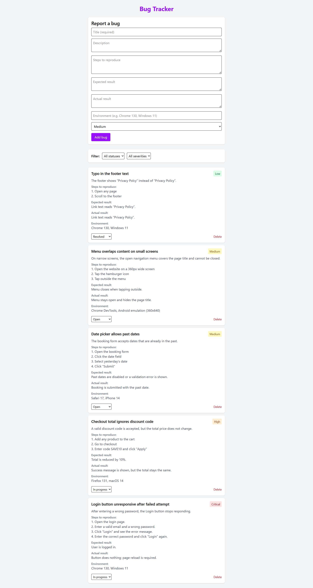

# Bug Tracker

A simple bug tracking app built with React, Vite and Tailwind CSS. Built as a portfolio project that combines frontend development with QA practices.

**Live demo:** <PASTE VERCEL LINK HERE>



## Features

- Report a bug with title, description, steps to reproduce, expected and actual result, environment and severity
- Form validation with an error message when the title is missing
- Change bug status (Open, In progress, Resolved)
- Filter bugs by status and severity
- Delete bugs
- Data is saved in the browser (localStorage), so bugs remain after a page reload

## Tech stack

- React (hooks: `useState`, `useEffect`)
- Vite
- Tailwind CSS
- Prettier for code formatting

## Run locally

```bash
npm install
npm run dev
```

## Test cases

| ID    | Title                      | Steps                                                                  | Expected result                                                                | Priority |
| ----- | -------------------------- | ---------------------------------------------------------------------- | ------------------------------------------------------------------------------ | -------- |
| TC-01 | Add bug with valid data    | Fill in the title, select a severity, click "Add bug"                  | Bug appears at the top of the list, form is cleared                            | High     |
| TC-02 | Add bug without title      | Leave the title empty, click "Add bug"                                 | Error "Title is required" is shown, no bug is added                            | High     |
| TC-03 | Title with spaces only     | Enter only spaces in the title, click "Add bug"                        | Error "Title is required" is shown, no bug is added                            | Medium   |
| TC-04 | Error disappears on typing | Trigger the title error, then type a character                         | Error message and red border disappear                                         | Medium   |
| TC-05 | Change bug status          | Change the status dropdown on a card                                   | Status updates only on that card                                               | High     |
| TC-06 | Delete bug                 | Click "Delete" on a card                                               | Only that bug is removed                                                       | High     |
| TC-07 | Empty state                | Delete all bugs                                                        | Message "No bugs found." is shown                                              | Low      |
| TC-08 | Filter by status           | Select "Open" in the status filter                                     | Only Open bugs are shown                                                       | High     |
| TC-09 | Combined filters           | Select a status and a severity                                         | Only bugs matching both are shown                                              | Medium   |
| TC-10 | Filter with no results     | Select a combination with no matches                                   | Message "No bugs found." is shown                                              | Low      |
| TC-11 | Persistence                | Add bugs, reload the page                                              | Bugs are still displayed                                                       | High     |
| TC-12 | Corrupted localStorage     | Set the key `bugs` to invalid text in DevTools, reload                 | App loads with an empty list, no crash                                         | Medium   |
| TC-13 | Full bug report            | Fill in all fields, including expected, actual and environment, submit | All fields are displayed on the card                                           | High     |
| TC-14 | Optional fields empty      | Fill in only the title, submit                                         | Card shows no empty labels for optional fields                                 | Medium   |
| TC-15 | Long text                  | Enter a very long title and description                                | Layout is not broken                                                           | Low      |
| TC-16 | Success message            | Add a valid bug                                                        | Message "Bug added successfully" is shown and disappears after about 3 seconds | Medium   |

## Known issues

- Filters reset to their default values after a page reload (by design)

## What I learned

- Structuring a React app into small, reusable components and passing data through props
- Managing state and side effects with hooks, including persistence in localStorage
- Applying a QA mindset to my own code: writing test cases, finding and fixing gaps such as missing validation feedback
